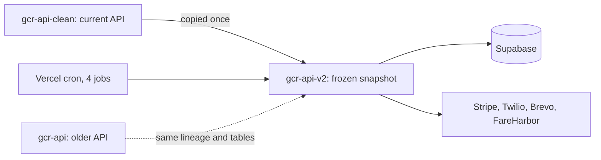

# gcr-api-v2

An older frozen copy of `gcr-api-clean`, kept as a starting point for a structured-data rebuild that continued elsewhere.

## What it is

A Node.js/Express back end for Gulf Coast Radar: businesses, menus, tourist accounts, bookings, SMS and email, payments and admin tools, stored in Supabase. The repo has one commit, "Initial copy from gcr-api-clean", and the package name inside `package.json` is still `gcr-api-clean`. Compared with a local checkout of `gcr-api-clean`, every file here also exists there, 55 files exist only there (for example `middleware/ownerAuth.js`, `lib/businessTables.js`, `lib/mcpServer.js`, `migrations/`, `docs/`), and about 35 shared files differ. So this is the older, smaller snapshot.

## How it works

- `server.js` builds an Express app and mounts about 53 route files from `routes/` through a `mount(path, loader)` helper. A route file that fails to load is skipped with a warning instead of stopping the server, and each loader contains a literal `require('./routes/...')` so Vercel bundles it.
- Mounted prefixes include `/api/auth`, `/api/gcr`, `/api/admin`, `/api/dashboard`, `/api/public`, `/api/user`, `/api/site`, `/api/menu-editor`, `/api/tourist`, `/api/tourist-auth`, `/api/apps`, `/api/platform`, `/api/sms`, `/api/qr`, `/api/links`, `/api/stripe`, `/api/square`, `/api/webhooks`, `/api/availability`, `/api/transportation`, `/api/integrations/fareharbor`, `/api/reviews`, `/api/bookings`, `/api/analytics`, `/api/email-parser` and more.
- Several routes are commented out as "UNMOUNTED: backing tables don't exist in the live DB", so it was written against the live database rather than the older ones.
- `vercel.json` deploys `server.js` with `@vercel/node` and defines four cron jobs: `/api/platform/cron/reminders` (hourly), `/api/gcr/deep-crawl/run` (every 30 min), `/api/email-parser/ical-import/run` (hourly) and `/api/transportation/expire` (every 5 min).
- The repo root also holds many one-off `import-*.js` and `check-*.js` scripts, several `.sql` files (`TOURIST_TABLES.sql` and others) and `data-imports/`.
- Data layer: Supabase through `@supabase/supabase-js`. Other dependencies include Stripe, Twilio, firebase-admin and the Anthropic SDK.

## Run it

```
npm install
npm start          # node server.js
npm run dev        # node --watch server.js
```

Env var names from `.env.example`: `GCR_SUPABASE_URL`, `GCR_SUPABASE_SERVICE_KEY`, `BREVO_API_KEY`, `FROM_EMAIL`, `FROM_NAME`, `APP_URL`, `API_BASE_URL`, `JWT_SECRET`, `NODE_ENV`. Individual routes read more (Stripe, Twilio and similar). I did not start the server while writing this.

## Status

Duplicate of `gcr-api-clean`: an older snapshot with none of the owner-scoping middleware or shared guards that `gcr-api-clean` added; new work happens there.

## Where it fits



## Related repos

- Duplicates `gcr-api-clean` (source of the copy); prefer that repo.
- Shares lineage and the `entity` / menu tables with `gcr-api`.
- Its import scripts and `data-imports/` overlap with the data in `gar-front-end-data`.
